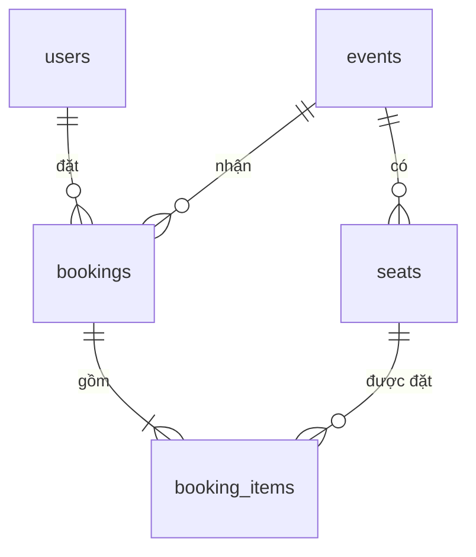

# Thiết kế database

## Quan hệ



## Schema

```sql
CREATE TABLE users (
    id            BIGINT GENERATED ALWAYS AS IDENTITY PRIMARY KEY,
    email         VARCHAR(255) NOT NULL UNIQUE CHECK (email = lower(email)),
    password_hash VARCHAR(100) NOT NULL,
    role          VARCHAR(20)  NOT NULL DEFAULT 'USER'
                  CHECK (role IN ('USER', 'ADMIN')),
    created_at    TIMESTAMPTZ  NOT NULL DEFAULT now()
);

CREATE TABLE events (
    id         BIGINT GENERATED ALWAYS AS IDENTITY PRIMARY KEY,
    name       VARCHAR(200) NOT NULL,
    venue      VARCHAR(200) NOT NULL,
    starts_at  TIMESTAMPTZ  NOT NULL,
    status     VARCHAR(20)  NOT NULL DEFAULT 'DRAFT'
               CHECK (status IN ('DRAFT', 'PUBLISHED', 'CANCELLED')),
    created_at TIMESTAMPTZ  NOT NULL DEFAULT now()
);

CREATE TABLE seats (
    id       BIGINT GENERATED ALWAYS AS IDENTITY PRIMARY KEY,
    event_id BIGINT      NOT NULL REFERENCES events (id),
    label    VARCHAR(20) NOT NULL,
    price    BIGINT      NOT NULL CHECK (price >= 0),
    status   VARCHAR(20) NOT NULL DEFAULT 'AVAILABLE'
             CHECK (status IN ('AVAILABLE', 'SOLD')),
    version  INTEGER     NOT NULL DEFAULT 0,
    UNIQUE (event_id, label)
);

CREATE TABLE bookings (
    id           BIGINT GENERATED ALWAYS AS IDENTITY PRIMARY KEY,
    user_id      BIGINT      NOT NULL REFERENCES users (id),
    event_id     BIGINT      NOT NULL REFERENCES events (id),
    status       VARCHAR(20) NOT NULL DEFAULT 'CONFIRMED'
                 CHECK (status IN ('CONFIRMED', 'CANCELLED')),
    total_amount BIGINT      NOT NULL CHECK (total_amount >= 0),
    created_at   TIMESTAMPTZ NOT NULL DEFAULT now()
);

CREATE TABLE booking_items (
    id           BIGINT GENERATED ALWAYS AS IDENTITY PRIMARY KEY,
    booking_id   BIGINT NOT NULL REFERENCES bookings (id),
    seat_id      BIGINT NOT NULL REFERENCES seats (id),
    price        BIGINT NOT NULL CHECK (price >= 0),
    cancelled_at TIMESTAMPTZ
);
```

## Lý do thiết kế

| Lựa chọn | Vì sao |
|---|---|
| Ghế tạo riêng cho từng sự kiện | Đơn giản, giá và trạng thái nằm một chỗ. Đánh đổi: lặp dữ liệu nếu nhiều sự kiện cùng địa điểm |
| Tiền dùng `BIGINT` (đồng) | Tránh sai số của số thực |
| `TIMESTAMPTZ` | Lưu đúng thời điểm, không phụ thuộc múi giờ máy chủ |
| `booking_items.price` | Giữ giá tại lúc mua |
| `seats.version` | Dùng cho optimistic lock (`@Version` trong JPA) |
| `cancelled_at` | Giữ lịch sử đơn huỷ |

Việc ghế có thuộc đúng sự kiện của đơn hay không được kiểm tra ở tầng service.

## Những thứ cố ý chưa thêm

Chỉ thêm sau khi làm thí nghiệm trong [bài thực hành](03-bai-thuc-hanh.md), để thấy được vấn đề trước.

```sql
-- Chốt chặn bán trùng ở tầng database
CREATE UNIQUE INDEX uq_booking_items_active_seat
    ON booking_items (seat_id) WHERE cancelled_at IS NULL;

-- Index phục vụ truy vấn
CREATE INDEX idx_bookings_user ON bookings (user_id, created_at DESC);
CREATE INDEX idx_booking_items_booking ON booking_items (booking_id);
CREATE INDEX idx_events_upcoming ON events (starts_at) WHERE status = 'PUBLISHED';
```

PostgreSQL không tự tạo index cho cột khoá ngoại. Riêng `seats(event_id)` đã được index nhờ `UNIQUE (event_id, label)`.
