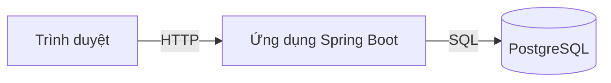

# System design là gì

## Ý chính

Viết code trả lời câu hỏi "làm sao cho tính năng chạy đúng". System design trả lời thêm: "làm sao nó **vẫn** chạy đúng và đủ nhanh khi có nhiều người dùng, nhiều dữ liệu, và có thứ bị hỏng".

Ví dụ đặt vé: một người đặt một ghế thì rất dễ. Khó là khi 10.000 người cùng giành 500 ghế lúc mở bán, database chậm đi, và một máy chủ chết giữa chừng.

## Một hệ thống web cơ bản

Giai đoạn 0 chỉ có chừng này. Các giai đoạn sau thêm cache, load balancer, hàng đợi, mỗi thứ để giải quyết một vấn đề cụ thể.

## Các từ sẽ gặp liên tục

| Từ | Nghĩa | Ví dụ |
|---|---|---|
| Latency | Thời gian xử lý một request | Xem sự kiện mất 50 ms |
| Throughput, QPS | Số request xử lý được mỗi giây | 100 request/giây |
| p95 | 95% request nhanh hơn con số này | p95 = 200 ms: cứ 100 request có khoảng 5 request chậm hơn 200 ms |
| Availability | Tỉ lệ thời gian hệ thống dùng được | 99,9% là được phép hỏng khoảng 43 phút mỗi tháng |
| Consistency | Mọi nơi nhìn thấy dữ liệu đúng và khớp nhau đến mức nào | Ghế đã bán thì không còn hiện là trống |
| Bottleneck | Chỗ nghẽn, giới hạn tốc độ của cả hệ thống | Database quá tải trong khi ứng dụng còn rảnh |
| Scale dọc | Dùng máy mạnh hơn | Tăng RAM, CPU |
| Scale ngang | Thêm máy | Chạy 3 instance ứng dụng |

Vì sao dùng p95 thay vì trung bình: 99 request mất 10 ms và 1 request mất 5 giây cho trung bình khoảng 60 ms, trông ổn nhưng có người phải chờ 5 giây.

## Không có đáp án đúng, chỉ có đánh đổi

| Làm gì | Được | Mất |
|---|---|---|
| Thêm cache | Đọc nhanh | Có thể đọc dữ liệu cũ |
| Thêm index | Truy vấn nhanh | Ghi chậm hơn, tốn dung lượng |
| Khoá dữ liệu | Không sai | Người khác phải chờ |
| Thêm máy | Chịu tải cao hơn | Phức tạp, khó giữ dữ liệu khớp nhau |

Câu trả lời tốt luôn có dạng: "tôi chọn A vì yêu cầu là X, chấp nhận mất Y".

## Tự kiểm tra

1. Latency thấp có đồng nghĩa với throughput cao không?
2. Trong dự án đặt vé, chỗ nào được phép hiển thị dữ liệu hơi cũ, chỗ nào tuyệt đối không?
3. Vì sao không nên thêm cache, hàng đợi, microservices ngay từ đầu?
